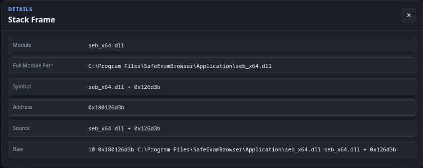
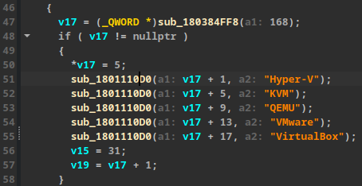
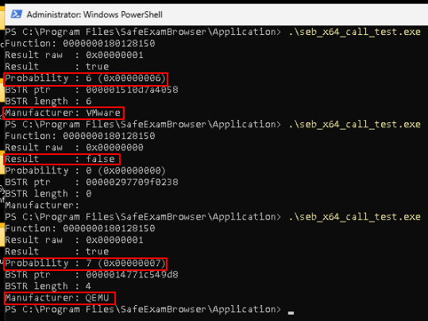
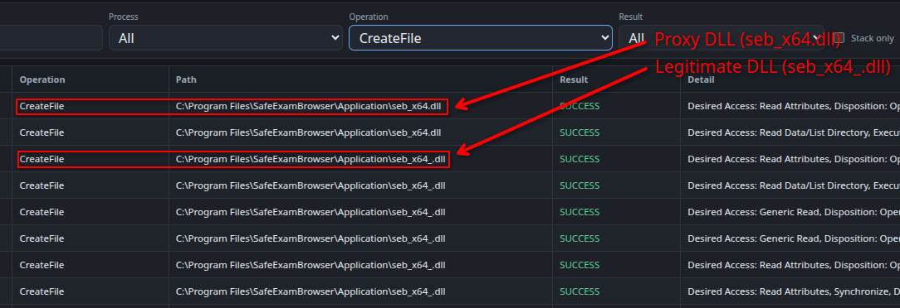
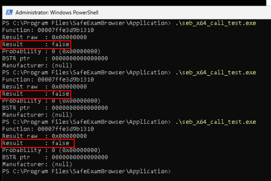
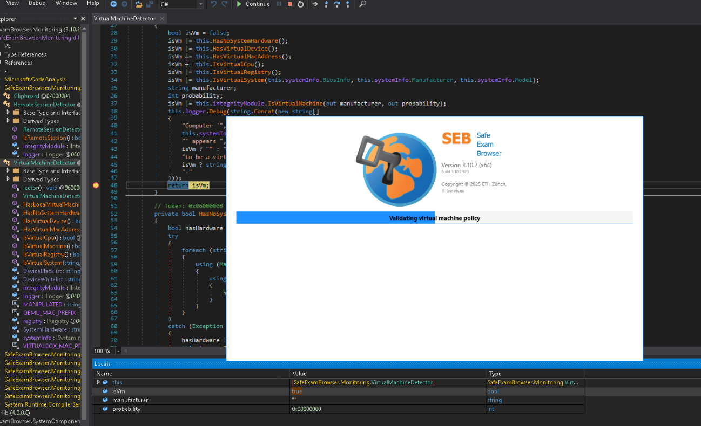
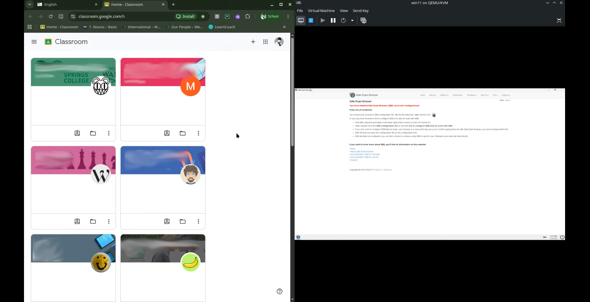
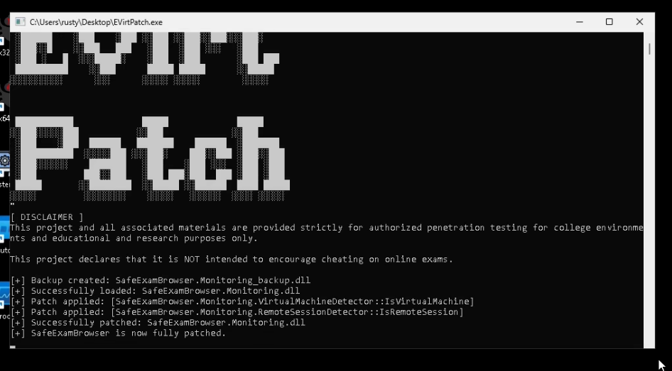
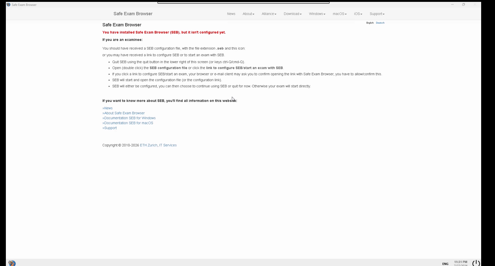

::github{repo="therustymate/EVirt_SEB"}

## Disclaimer
This project and all associated materials are provided strictly for authorized penetration testing for college environments and educational and research purposes only.

This project declares that it is NOT intended to encourage cheating on online exams.


## Executive Summary
This research investigates potential vulnerabilities in Safe Exam Browser (SEB) that could allow students to bypass its virtual machine (VM) detection mechanisms.
The scope of this project covered [Windows Safe Exam Browser v3.10.2](https://github.com/SafeExamBrowser/seb-win-refactoring/releases/tag/v3.10.2) 
and was tested on `Windows 11 10.0.26200 Build 26200` in `KVM/QEMU 10.2.2`.

The ultimate goal of this project was to identify potential VM detection bypass-related vulnerabilities through static and dynamic reverse engineering and propose possible mitigations against identified vulnerabilities.


## Project Overview

### Dynamic Reverse Engieerning
After installing the Safe Exam Browser, I launched the application to observe the log of the application to briefly analyze the execution flow of the application.
The execution flow was:
1. Initialize startup procedure
    - Load system language
2. Start communication host
    - Open a net pipe: net.pipe://localhost/safeexambrowser/runtime/[UUID]
3. Verify application and runtime integrity
4. Initialize new session configuration
    - Load Client-ID
    - Load Runtime-ID
    - Load Session-ID
5. Initialize application configuration
6. Validate version restrictions
7. Validate remote session policy
8. Validate session integrity
    - Disable sticky keys
    - Start cursor verification
    - Start ease of access verification
9. Validate virtual machine policy
10. Continue OR Exit

I launched Process Monitor (ProcMon) and examined the `2026-07-21_20h46m25s_Runtime.log` file. 
The log entries indicated that the VM validation process began at `20:46:56.551` and ended at `20:46:58.012`. 

```bash
$ cat 2026-07-21_20h46m25s_Runtime.log | grep "virtual"
2026-07-21 20:46:56.551 [11] - INFO: Validating virtual machine policy...
2026-07-21 20:46:57.996 [11] - DEBUG: [VirtualMachineDetector] Computer 'THERUSTYMATE' appears to be a virtual machine (QEMU, 100%).
2026-07-21 20:46:58.012 [11] - ERROR: Detected virtual machine while SEB is not allowed to be run in a virtual machine! Aborting...
```

After exporting all ProcMon events to a CSV file, I used `grep` with an extended regular expression to filter events recorded during the VM validation process:

`cat ProcMon_SEB.csv | grep ".531"`

and

`grep -E '^"?20:46:(56|57|58)\.' ProcMon_SEB.csv`

```bash
$ cat ProcMon_SEB.csv | grep ".531"
"8:46:23.9355311 PM","SafeExamBrowser.exe","6960","Load Image","C:\Windows\System32\msvcp_win.dll","SUCCESS","Image Base: 0x7ffef0010000, Image Size: 0xa3000"
```

```bash
$ cat ProcMon_SEB.csv | grep -E "^......56|^......57|^......58"
...
"8:46:56.9634035 PM","SafeExamBrowser.exe","6960","RegOpenKey","HKLM\System\CurrentControlSet\Enum\SWD\MMDEVAPI\MICROSOFTGSWAVETABLESYNTH","SUCCESS","Desired Access: Query Value, Maximum Allowed"
"8:46:56.9634116 PM","SafeExamBrowser.exe","6960","RegQueryValue","HKLM\System\CurrentControlSet\Enum\SWD\MMDEVAPI\MicrosoftGSWavetableSynth\HardwareID","NAME NOT FOUND","Length: 4,108"
"8:46:56.9634185 PM","SafeExamBrowser.exe","6960","RegCloseKey","HKLM\System\CurrentControlSet\Enum\SWD\MMDEVAPI\MicrosoftGSWavetableSynth","SUCCESS",""
...
``` 

Then, I used a custom python script (`procmon_csv_parser.py`) to list unique items on selected columns within the ProcMon CSV file.

```bash
$ python3 procmon_csv_parser.py -c 5 -f ../research/dynamic/outputs/ProcMon_SEB_modified02.csv
...
HKLM\System\CurrentControlSet\Services\Tcpip\Parameters
HKLM\System\CurrentControlSet\Services\Tcpip\Parameters\Domain
HKLM\System\CurrentControlSet\Services\Tcpip\Parameters\Hostname
...
```

To further analyze the events on Linux, I used [ProcMonParser](https://therustymate.com/ProcMonParser/), a tool I had previously developed to analyze ProcMon events recorded during SEB execution.




The stack trace suggested that the native DLL `seb_x64.dll` invoked the Windows API function `RegGetValueW` to retrieve registry values.
Based on these observations, I suspected that `seb_x64.dll` might be involved in VM validation process of SEB.


### Static Reverse Engineering
To investigate this further, I began a static analysis of `seb_x64.dll`.


```bash
$ file seb_x64.dll
seb_x64.dll: PE32+ executable for MS Windows 6.00 (DLL), x86-64, 12 sections
```

Unexpectedly, I discovered that the DLL was protected by [Themida Protector](https://www.oreans.com/Themida.php).


First, I expected the decompiled output to be unreliable due to this protection. 
However, I was still able to partially recover some functions listed in the Export Address Table (EAT).

Before proceeding with the reverse engineering of `seb_x64.dll`, I first analyzed the publicly available .NET component.

```cs
public bool IsVirtualMachine(out string manufacturer, out int probability)
{
    var isVirtualMachine = false;

    manufacturer = default;
    probability = default;

    try
    {
        isVirtualMachine = Native.IsVirtualMachine(out var bstr, out probability);

        if (bstr != IntPtr.Zero)
        {
            manufacturer = Marshal.PtrToStringBSTR(bstr);
            Marshal.FreeBSTR(bstr);
        }
    }
    catch (DllNotFoundException)
    {
        logger.Warn("Integrity module is not available!");
    }
    catch (Exception e)
    {
        logger.Error("Unexpected error while attempting to query virtual machine information!", e);
    }

    return isVirtualMachine;
}
```

Through this analysis, I identified the following function signature for `IsVirtualMachine`, 
which could help me interpret the decompiled code of `seb_x64.dll`:

```c
extern "C" bool __cdecl IsVirtualMachine(
    BSTR* manufacturer,
    int* probability
);
```

Upon examining the decompiled code, I immediately noticed several hypervisor-related strings.



I began analyzing the code associated with these strings using a GPT-based LLM,
focusing on `StringConstruct`, which I suspected was related to C++ string handling.

```c
char IsVirtualMachine(BSTR *manufacturer,int *probability)

{
    char codeSignatureValid;
    byte vmProbability;
    undefined4 randomSeed;
    uint randomValue;
    int randomVendorValue;
    VmContext *vmContext;
    BSTR manufacturerBstr;
    VendorList *vendorAllocation;
    MsvcString *manufacturerStringA;
    WString32 *wideManufacturer;
    wchar_t *manufacturerWideBuffer;
    char isVirtualMachine;
    int probabilityValue;
    MsvcString *vendorList;
    MsvcString *selectedVendor;
    VmContext detectionContext;
    VmContext manufacturerContext;
    VmContext probabilityContext;
    WString32 manufacturerString;
    WString32 fallbackManufacturerString;
    MsvcString emptyVendor;
    MsvcString selectedVendorCopy;
    MsvcString manufacturerStorage;
    MsvcString movedVendor;
    
                    /* 0x128150  4  IsVirtualMachine */
    codeSignatureValid = VerifyCodeSignature();
    if (codeSignatureValid == '\0') {
        vendorAllocation = alloc(168);
        if (vendorAllocation == (VendorList *)0x0) {
            vendorList = (MsvcString *)0x0;
        }
        else {
            vendorAllocation->count = 5;
            StringConstruct(vendorAllocation->vendors,"Hyper-V");
            StringConstruct(vendorAllocation->vendors + 1,"KVM");
            StringConstruct(vendorAllocation->vendors + 2,"QEMU");
            StringConstruct(vendorAllocation->vendors + 3,"VMware");
            StringConstruct(vendorAllocation->vendors + 4,"VirtualBox");
            vendorList = vendorAllocation->vendors;
        }
        randomSeed = std_time(0);
        std_srand(randomSeed);
        randomValue = std_rand();
        isVirtualMachine = (randomValue & 1 ^ (int)randomValue >> 0x1f) - ((int)randomValue >> 0x1f) == 1;
        if (!(bool)isVirtualMachine) {
            selectedVendor = StringConstruct(&emptyVendor,"");
        } else {
            randomVendorValue = std_rand();
            selectedVendor = StringCopy(&selectedVendorCopy,vendorList + randomVendorValue % 5);
        }
        manufacturerStringA = StringMove(&movedVendor,selectedVendor);
        wideManufacturer = ConvertStringToWString(&fallbackManufacturerString,manufacturerStringA);
        manufacturerWideBuffer = WStringData(wideManufacturer);
        manufacturerBstr = (BSTR)(*(code *)0x8000000000000002)(manufacturerWideBuffer);
        *manufacturer = manufacturerBstr;
        WStringDestroy(&fallbackManufacturerString);
        if (!(bool)isVirtualMachine) {
            StringDestroy(&emptyVendor);
            probabilityValue = 0;
        }
        else {
            StringDestroy(&selectedVendorCopy);
            probabilityValue = std_rand();
            probabilityValue = probabilityValue % 0x65;
        }
        *probability = probabilityValue;
    }
    else {
        vmContext = BuildVmContext(&detectionContext);
        isVirtualMachine = IsVmDetected(vmContext);
        vmContext = BuildVmContext(&manufacturerContext);
        manufacturerStringA = GetVmManufacturerString(&manufacturerStorage,vmContext);
        wideManufacturer = ConvertStringToWString(&manufacturerString,manufacturerStringA);
        manufacturerWideBuffer = WStringData(wideManufacturer);
        manufacturerBstr = (BSTR)(*(code *)0x8000000000000002)(manufacturerWideBuffer);
        *manufacturer = manufacturerBstr;
        WStringDestroy(&manufacturerString);
        vmContext = BuildVmContext(&probabilityContext);
        vmProbability = GetVmProbability(vmContext);
        *probability = (uint)vmProbability;
    }
    return isVirtualMachine;
}
```

`seb_types.h` for Ghidra:

```c
typedef struct MsvcString {
    union {
        char inlineBuffer[16];
        char *heapBuffer;
    } storage;

    unsigned long long size;
    unsigned long long capacity;
} MsvcString;

typedef struct WString32 {
    union {
        wchar_t inlineBuffer[8];
        wchar_t *heapBuffer;
    } storage;

    unsigned long long size;
    unsigned long long capacity;
} WString32;

typedef struct VendorList {
    unsigned long long count;
    MsvcString vendors[5];
} VendorList;

typedef struct VmContext {
    uint64_t bits[2];
} VmContext;
```

After completing the decompilation, I used a GPT-based LLM to transform the decompiled output into more human-readable C++ code.

```cpp
bool IsVirtualMachine(BSTR* manufacturer, int* probability)
{
    if (!VerifyCodeSignature())
    {
        VendorList* vendors = alloc(168);

        if (vendors)
        {
            vendors->count = 5;
            vendors->vendors[0] = "Hyper-V";
            vendors->vendors[1] = "KVM";
            vendors->vendors[2] = "QEMU";
            vendors->vendors[3] = "VMware";
            vendors->vendors[4] = "VirtualBox";
        }

        std::srand(std::time(nullptr));

        bool isVirtualMachine = (std::rand() % 2) != 0;

        std::string vendor;

        if (isVirtualMachine)
        {
            vendor = vendors->vendors[std::rand() % 5];
        }

        std::wstring wideVendor(vendor.begin(), vendor.end());

        // Failed Recovery:
        // This can be string related function (different compare to the below Themida protected function.)
        *manufacturer =
            reinterpret_cast<BSTR (*)(const wchar_t*)>(
                0x8000000000000002
            )(wideVendor.c_str());

        *probability =
            isVirtualMachine ? std::rand() % 101 : 0;

        return isVirtualMachine;
    }

    VmContext detectionContext;
    VmContext manufacturerContext;
    VmContext probabilityContext;

    bool isVirtualMachine =
        IsVmDetected(
            BuildVmContext(&detectionContext)
        );

    std::string manufacturerString =
        GetVmManufacturerString(
            BuildVmContext(&manufacturerContext)
        );

    std::wstring wideManufacturer(
        manufacturerString.begin(),
        manufacturerString.end()
    );

    // Failed Recovery:
    // This function is likely the main VM detection function protected by Themida.
    *manufacturer =
        reinterpret_cast<BSTR (*)(const wchar_t*)>(
            0x8000000000000002
        )(wideManufacturer.c_str());

    *probability =
        GetVmProbability(
            BuildVmContext(&probabilityContext)
        );

    return isVirtualMachine;
}
```

### Vulnerability Research
Although the reconstructed code was not entirely reliable, I was still able to make several observations and draw tentative conclusions from the analysis.

Initially, I suspected that an attacker could bypass the VM detection mechanism by manipulating the random number generator (RNG), as the program appeared to return a randomized VM detection result when code signature verification failed.

I confirmed that the component returns a randomized result when integrity verification fails. I suspected that this might be an intentional deceptive behavior.



I confirmed that VM validation process had been successfully bypassed.





However, SEB still detected that it was running inside a virtual machine.

After further investigating this vulnerability, I identified two additional factors that affect the VM validation process.

* First, I discovered that the native component `seb_x64.dll` was not the only component involved in the VM validation process.
* Second, I found that, in my specific testing environment, bypassing remote session detection was also necessary to determine whether the vulnerability could actually be exploited.


```cs
...
public bool IsVirtualMachine()
{
    var isVm = false;

    isVm |= HasNoSystemHardware();
    isVm |= HasVirtualDevice();
    isVm |= HasVirtualMacAddress();
    isVm |= IsVirtualCpu();
    isVm |= IsVirtualRegistry();
    isVm |= IsVirtualSystem(systemInfo.BiosInfo, systemInfo.Manufacturer, systemInfo.Model);
    isVm |= integrityModule.IsVirtualMachine(out var manufacturer, out var probability);

    logger.Debug($"Computer '{systemInfo.Name}' appears {(isVm ? "" : "not ")}to be a virtual machine{(isVm ? $" ({manufacturer}, {probability}%)" : "")}.");

    return isVm;
}
...
```

Another bypass method I attempted involved manipulating the VM validation result using dnSpy and combining it with the DLL hijacking technique I had previously tested.

As a result, I successfully bypassed both the VM and remote session validation mechanisms, allowing me to access external resources while running SEB.





Using `dnlib`, I developed a PoC tool to automate the SEB patching process previously validated manually using dnSpy. 
Testing confirmed that the PoC tool also successfully bypasses VM validation.







The setup procedure is as follows:
1. Install [virtio-win-0.1.285](https://fedorapeople.org/groups/virt/virtio-win/direct-downloads/archive-virtio/virtio-win-0.1.285-1/) drivers.
2. Use VirtIo video model type in KVM/QEMU.
3. Reboot.
4. Install SafeExamBrowser.
5. Apply EVirtPatch.
6. Manually apply seb_x64.dll DLL proxy.

*Note: If the SEB displays internal/external display-related warnings, please modify the VM configuration to use VirtIO drivers for the video model.*

### Conclusion
Using the `SafeExamBrowser.Monitoring.dll` patch, the virtual machine and remote session detection of the SafeExamBrowser was successfully bypassed. However, this patch triggers both the code and runtime integrity verification failure. Furthermore, the 7th layer of the virtual machine detection layers and the 2nd layer of the remote session detection layers can log both the virtual machine detection results and the remote session detection results.

Using the `seb_x64.dll` patch, the integrity verification results were manipulated, leading to a successful integrity verification bypass. The patch also manipulates the external virtual machine and remote session detections (7th layer of virtual machine detection layers & 2nd layer of remote session detection layers), leading to a complete detection bypass.


## Limitations
* **ASK & BEK**: The App Signature Key (ASK) and Browser Exam Key (BEK) are additional server-side verification mechanisms used to ensure application integrity.
* **Phyiscal Security**: Supervisors can physically monitor students' PC which may detect attemps to cheat on online exams.
* **Reality**: Realistically students cannot easily configure and control virtual machines to cheat on online exams. This may require knowledges related to virtual machine configurations.


## Tested Environment Specification
The research was conducted across four operating system environments:
* `Fedora Linux 44 (KDE)`
* `Debian Linux 13 (trixie)`
* `Windows 11 Home (Build 26200)`
* `Windows 11 Pro (Build 26200)`

### Fedora Linux Host

| Environment           | Information                                       |
|:----------------------|:--------------------------------------------------|
| Operating System      | Fedora Linux 44 KDE Plasma Desktop Edition        |
| Virtualization Engine | QEMU emulator version 10.2.2 (qemu-10.2.2-1.fc44) |
| Architecture          | Intel x64                                         |

### Debian Linux Host

| Environment           | Information                                       |
|:----------------------|:--------------------------------------------------|
| Operating System      | Debian GNU/Linux 13 (trixie) x86_64               |
| Virtualization Engine | QEMU emulator version 10.0.11 (qemu-10.2.2-1.fc44)|
| Architecture          | Intel x64                                         |

### Windows 11 Home Guest

| Item                              | Value                                             |
|:----------------------------------|:--------------------------------------------------|
| **OS**                            | Microsoft Windows 11 Pro                          |
| **OS Version**                    | 10.0.26200 Build 26200                            |
| **OS Manufacturer**               | Microsoft Corporation                             |
| **System Name**                   | DESKTOP-1L5BAXH                                   |
| **System Manufacturer**           | QEMU                                              |
| **System Model**                  | Standard PC (Q35 + ICH9, 2009)                    |
| **System Type**                   | x64-based PC                                      |
| **Processor**                     | 11th Gen Intel(R) Core(TM) i5-1135G7              |
| **BIOS Version**                  | Debian distribution of EDK II 2025.02-8+deb13u1   |
| **SMBIOS Version**                | 2.8                                               |
| **BIOS Mode**                     | UEFI                                              |
| **Platform Role**                 | Desktop                                           |
| **Secure Boot State**             | On                                                |
| **Installed Physical Memory**     | 8.00 GB                                           |
| **Kernel DMA Protection**         | Off                                               |
| **Virtualization-based Security** | Not enabled                                       |
| **Hypervisor Bit**                | Detected                                          |

### Windows 11 Pro Guest

| Item                              | Value                                 |
|:----------------------------------|:--------------------------------------|
| **OS**                            | Microsoft Windows 11 Home             |
| **OS Version**                    | 10.0.26200 Build 26200                |
| **OS Manufacturer**               | Microsoft Corporation                 |
| **System Name**                   | THERUSTYMATE                          |
| **System Manufacturer**           | QEMU                                  |
| **System Model**                  | Standard PC (Q35 + ICH9, 2009)        |
| **System Type**                   | x64-based PC                          |
| **Processor**                     | 11th Gen Intel(R) Core(TM) i5-1135G7  |
| **BIOS Version**                  | EDK II edk2-20260508-6.fc44, 5/8/2026 |
| **SMBIOS Version**                | 2.8                                   |
| **BIOS Mode**                     | UEFI                                  |
| **Platform Role**                 | Desktop                               |
| **Secure Boot State**             | On                                    |
| **Installed Physical Memory**     | 8.00 GB                               |
| **Kernel DMA Protection**         | Off                                   |
| **Virtualization-based Security** | Not enabled                           |
| **Hypervisor Bit**                | Detected                              |


## References
* [https://safeexambrowser.org/download_en.html](https://safeexambrowser.org/download_en.html)
* [https://github.com/SafeExamBrowser/seb-win-refactoring/releases/tag/v3.10.2](https://github.com/SafeExamBrowser/seb-win-refactoring/releases/tag/v3.10.2)
* [https://en.wikipedia.org/wiki/Virtual_machine](https://en.wikipedia.org/wiki/Virtual_machine)
* [https://learn.microsoft.com/en-us/windows/win32/wmisdk/wmi-start-page](https://learn.microsoft.com/en-us/windows/win32/wmisdk/wmi-start-page)
* [https://en.wikipedia.org/wiki/Windows_Registry](https://en.wikipedia.org/wiki/Windows_Registry)